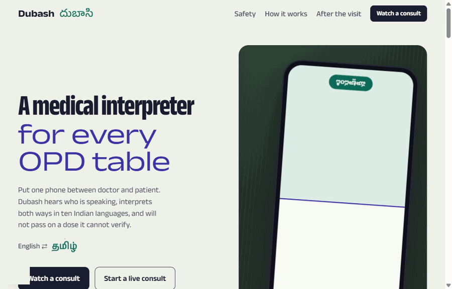
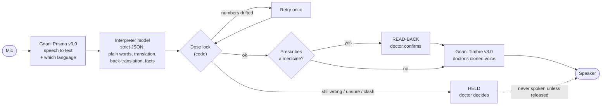

<div align="center">

# Dubash · దుబాసి

### A medical interpreter for Indian OPDs that would rather say nothing than say the wrong dose.

**[Live demo](https://dubash-seven.vercel.app)** · [One-page pitch](docs/pitch.md) · [Design research](docs/research.md)

Built for the **Gnani Great Indian AI Internship Challenge** · #GnaniAI #GreatIndianAIInternshipChallenge



*The scripted demo consult, start to finish. Every person and case is synthetic.*

</div>

---

## The idea in 30 seconds

*Dubash* (दुभाषिया) means the interpreter who stands between two people who don't share a language.

One phone lies on the consultation table. The **doctor** speaks English or Hinglish. The **patient** speaks Telugu, Tamil,
Kannada, Hindi, Bengali, Malayalam, Marathi, Gujarati, Punjabi or Hinglish. Dubash:

1. **hears** both and works out who spoke,
2. **interprets** both ways, speaking to the patient in the doctor's own (cloned, consented) voice,
3. **checks every dose** before the patient hears it, and stays silent if it cannot,
4. **confirms the patient understood**, then prints a take-home slip in their language,
5. **keeps helping after the visit**: the slip answers the family's questions and checks medicine packs.

## Try it in two minutes

No keys, no microphone: open the **[live demo](https://dubash-seven.vercel.app)** → **Watch a consult** → **Play all**.

| Watch for | What you are seeing |
|---|---|
| Turn 9 | A prescription waits for the doctor's **read-back** before it is spoken |
| Turn 10 | **Held**: amoxicillin, for a patient who said she reacts to penicillin |
| Turn 12 | The **dose lock** catches a lost "2" and fixes it |
| Teach-back | 4 of 7 understood → **Ask again** → 7 of 7 |
| Wrap-up | A cited clinical note and the take-home slip, with a line for the chemist and a QR code |

## Why this exists

- In Indian OPDs, doctor and patient often don't share a language. A relative or a ward boy interprets, often badly.
- In one survey of 500 Delhi outpatients, **75.2% could not read English** (the language of their prescription) and only **1.8% fully understood their medicines**.
- Machine interpreting fails exactly where it hurts: numbers and shorthand. *"Hold the medicine"* means *stop*; word for word it becomes *keep taking it*. A 2026 preprint put AI interpreting at about **33%** clinically significant errors against about **5%** for human interpreters.

Dubash is built around that failure. It does not just translate: it refuses to pass a turn on when the numbers don't survive.

<sub>Figures are quoted from the sources in `research/`; re-checking each against its original is still open in `tasks/todo.md`.</sub>

## What it does

### In the room

| Feature | In one line |
|---|---|
| **Split consult screen** | Doctor's half and patient's half; on a phone the patient's half is upside down so each reads their own side |
| **Speaker by language** | Prisma hears two languages and reports which one: that is who spoke. No speaker-ID model |
| **Speak to start** | Unsure of the language? The patient says anything and Prisma names it |
| **Hinglish** | A patient language of its own, written in Roman script the way people type it |
| **Doctor's own voice** | 10 consented seconds become a voice clone; the patient hears their doctor |
| **Dose lock** | Every number must survive translation, or the turn is not spoken |
| **Read-back** | A prescription is shown back (drug, strength, timing) and waits for one tap |
| **Asks instead of guessing** | An unclear instruction comes back with a question and two readings to tap |
| **Pinned patient facts** | Allergies, current medicines, conditions stay on screen and feed the clash check |
| **Family turns** | A son or daughter can speak for the patient; the note records who said what |
| **Quick phrases** | Six everyday questions with fixed wording: no model, nothing to mistranslate |
| **"I didn't understand"** | The patient's own button: same instruction, simpler words, slower |
| **Teach-back, in rounds** | The patient says the plan back; Dubash scores it and re-asks only what was missed |
| **Wrap-up** | A clinical note where every line cites its turn, plus the take-home slip |

### After the visit

| Feature | In one line |
|---|---|
| **Ask the slip** | The family asks by voice at home; the answer comes only from the slip, else "ask your doctor" |
| **Check the strip** | Photograph a medicine pack; Dubash says whether it matches the slip |
| **A line for the chemist** | The same medicines in English, with the quantity worked out in code |
| **Returning patient** | Scan the old slip at the next visit: last time's medicines and allergies come back. Nothing stored |

<details>
<summary><b>More detail on each feature</b></summary>

| Feature | What happens |
|---|---|
| **Live consult screen** | Tap-to-talk on each side sends by itself when the speaker pauses; tapping a mic also cuts off Dubash if it is still talking. Hands-free mode detects voice automatically. |
| **Hinglish** | Gnani has no Hinglish code, so Prisma `en-IN` transcribes it in Roman script, Timbre's `hi-IN` voice speaks it, and the interpreter writes Roman-script Hinglish. In auto mode it is detected as `hi-IN`, then re-heard with `en-IN`. Use the two mic buttons: a doctor who also speaks Hinglish can be mistaken for the patient. |
| **Faithful interpretation** | First person, spoken register, digits kept. Patient → doctor turns also surface **red flags** (chest pain, bleeding, pregnancy…). |
| **Read-back** | The dose lock compares translation with transcript, so it cannot see a number the microphone misheard. The doctor can. The card shows the sentence as Dubash understood it and a table of drug, dose, timing and duration. |
| **Pinned patient facts** | Pulled from what the patient or family says, plus anything carried over from the last visit's slip. Sent to the interpreter on every turn, so the clash check still works after the allergy has scrolled out of recent history. |
| **"I didn't understand"** | The simpler wording goes through the same dose lock; if a number moved, the original audio is replayed slowly instead. |
| **Teach-back** | Each plan item is marked understood / partial / missed / wrong. **Ask again** re-checks only the missed items; **Ask just this** puts one short question to the patient. The score goes on the clinical note. |
| **Wrap-up** | Every number on the note and the slip is checked against what was actually said. The slip has audio, a picture card for patients who cannot read, a chemist line and a QR code. |
| **Zero-key demo** | A scripted 12-turn Telugu consultation through the exact same UI, with pre-baked Gnani voices. |
| **Also** | Latency chips per turn (STT, interpretation, voice); a running "medicines so far" list from released turns only; a failed turn keeps its audio and re-sends with one tap. |

</details>

## How a turn works

One request to `POST /api/turn` does all of this:



1. **Hear.** Prisma v3.0 gets up to two language codes, about 170 medical keyterms (drug names, `BD`, `1-0-1`, `HbA1c`…), a topic hint and the previous utterance. If v3.0 is busy, single-language turns fall back to Prisma v2.5.
2. **Who spoke.** Detected language equals the patient's language → patient; otherwise doctor. Tap-to-talk fixes the side.
3. **Interpret.** The model returns structured JSON: translation, plain-language rewrite of shorthand, back-translation, red flags, confidence, clashes, new patient facts, and a clarifying question when unsure.
4. **Check.** The dose lock compares numbers between source and translation, in code.
5. **Speak.** Unless the turn is held or awaits read-back, Timbre speaks it. If Timbre v3.0 is busy, it falls back to a per-language v2.5 voice.

## Safety layer

The rule throughout: **the model proposes, plain code decides.**

| Check | Rule | If it fails |
|---|---|---|
| **Dose lock** | Every number and dose word in the source (`650`, `twice`, `1-0-1`, `5 days`) must appear in the translation, and nothing new may appear. Native digits (`५००`, `৫০০`) count as the same numbers. | One corrective retry, then **held** |
| **Read-back** | A doctor turn naming a medicine with a dose or frequency is shown back first | Not spoken until the doctor taps "Yes, say it" |
| **Shorthand rewrite** | `hold`, `BD`, `TDS`, `OD`, `SOS`, `PRN`, `stat`, `NPO`, `taper`, `HS`… become plain words *before* translation | The doctor sees the rewrite and can correct it |
| **Back-translation** | The translation is put back into English for the doctor | Drift is visible at a glance |
| **Unsure** | The model reports low confidence, or attaches a clarifying question | **Held**, with the two readings as buttons when it can name them |
| **Clash** | The instruction contradicts something the patient said, or a pinned fact (amoxicillin after a penicillin allergy) | **Held** until the doctor decides |
| **Simpler wording** | "I didn't understand" rewrites an instruction | Dose-locked again; on failure the original is replayed slowly |
| **Wrap-up grounding** | Every number on the note or slip must have been said in the turns that line cites (`lib/verify.js`) | Flagged in red: "Check before printing" |

A held turn is **never spoken to the patient**, never counted in teach-back and never written on the note or slip until the doctor releases it. The patient's screen keeps the last thing they actually heard.

### After the visit, the same rule

The slip lives in the URL fragment of its QR code, so opening it sends nothing to a server. Each feature sends the slip with its request and nothing is kept.

| Feature | How it stays safe |
|---|---|
| **Tap a medicine** | Reads that medicine's own line from the slip. No model |
| **Ask the slip** | The model may answer only from the slip. Code then requires that it said it found the answer *and* that every number in the answer is printed on the slip. Otherwise the family hears one fixed sentence: "That is not on this slip. Please ask your doctor." |
| **Check the strip** | The vision model only reads the print (brand, generic, strength). Code decides: match, wrong strength, not on the slip, or unreadable. The photo is not stored |
| **Chemist line** | Tablets a day × days, computed in code. Courses with no end date show "ongoing / as advised", never an invented total |
| **Returning patient** | The QR also carries allergies, conditions and pregnancy status as short English phrases; scanning it pins them and feeds the clash check |

## Models used

| Purpose | Model | Provider |
|---|---|---|
| Speech-to-text, language detection | **Prisma v3.0** (fallback v2.5) | Gnani Vachana API |
| Text-to-speech | **Timbre v3.0** (fallback v2.5) | Gnani Vachana API |
| Doctor's voice | **Vachana voice clone** (`vachana-vc-v1`) | Gnani Vachana API |
| Interpretation, teach-back, note, simpler wording, ask-the-slip | **OpenAI `gpt-4.1`** by default; or **Gnani Evon v3.3** self-hosted; or **Claude** | OpenAI / self-hosted / Anthropic |
| Reading a medicine pack | The same model with an image (OpenAI or Claude; a text-only Evon returns 501 for this one route) | OpenAI / Anthropic |

The interpreter is chosen by environment variables, in this order: `EVON_BASE_URL` → `OPENAI_API_KEY` → `ANTHROPIC_API_KEY`. Every call uses strict JSON-schema output, so the code never parses free text.

## Run it locally

Needs Node.js 20+. The scripted demo runs with no keys; live mode needs a Gnani Vachana key and one interpreter key.

```bash
git clone https://github.com/RAHUL-17-rrs/dubash.git
cd dubash
npm install
cp .env.example .env.local    # then fill in the keys
npm run dev                   # http://localhost:3000
```

```ini
# .env.local
GNANI_API_KEY=vach_...           # STT, TTS, voice clone

# Interpreter model: set one
OPENAI_API_KEY=sk-...
OPENAI_MODEL=                    # optional, default gpt-4.1
ANTHROPIC_API_KEY=
LLM_MODEL=                       # optional Claude model override
EVON_BASE_URL=                   # self-hosted Gnani Evon (OpenAI-compatible); takes priority when set
EVON_API_KEY=
EVON_MODEL=
```

Open `/consult`, pick the patient's language (or let the patient speak), allow the microphone, and talk. `GET /api/status` shows which providers the server can see.

<details>
<summary><b>Deploy to Vercel</b></summary>

```bash
npx vercel link
npx vercel env add GNANI_API_KEY production
npx vercel env add OPENAI_API_KEY production
npx vercel --prod
```

The microphone and camera need HTTPS, which Vercel provides. Every model-backed route sets `maxDuration = 60`.
Regenerate the demo audio after changing `lib/demo.js`: `GNANI_API_KEY=vach_... node scripts/bake-demo.mjs`.

</details>

## Testing

```bash
node --test lib/*.test.mjs   # dose lock (incl. native digits), wrap-up grounding, slip encoding, chemist quantities,
                             # ask-the-slip grounding, strip matching, phrase coverage for every language, prompts
npm run build                # production build
npm run shots                # Playwright screenshots of every screen (needs a running server)
```

<details>
<summary><b>End-to-end test of every route, with no keys</b></summary>

`scripts/e2e-mock.mjs` runs local stand-ins for Gnani and the interpreter model:

```bash
node scripts/e2e-mock.mjs serve      # terminal 1: stand-in Prisma, Timbre and chat-completions on :4010
GNANI_API_KEY=mock GNANI_BASE_URL=http://localhost:4010 OPENAI_API_KEY=mock OPENAI_BASE_URL=http://localhost:4010 \
  npx next dev -p 3123               # terminal 2: the app, pointed at the stand-ins
BASE=http://localhost:3123 node scripts/e2e-mock.mjs   # terminal 3: the checks
```

It asserts, through the real routes: a plain turn is spoken at once; a prescription waits for read-back with no audio;
numbers lost twice hold the turn; an unsure turn comes back with two readings; a fact carried over from the last visit
stops a clashing prescription; family and hands-free turns are labelled; language detection; a simpler rewrite that
moves a number is discarded; teach-back round 2 checks only the missed items; ask-the-slip refuses an invented number;
a strip of the wrong strength is caught; bad uploads are rejected. `GNANI_BASE_URL` and `OPENAI_BASE_URL` exist only
for this; leave them unset in production.

</details>

## What has and has not been verified

Stated plainly, because this is a safety tool.

**Verified**

- **Unit tests** for every check that is made in code.
- **In a browser** at desktop (1440 px) and phone (390 px) widths, on the scripted demo: read-back, the penicillin hold, pinned facts, the dose-lock catch, both teach-back rounds, the note and slip, the chemist line, the QR carrying the allergy, the slip page, no horizontal overflow, and nothing hidden under reduced motion.
- **End to end against stand-in providers**: every route and the UI paths that use them.
- **Against real Gnani (Prisma v3.0, Timbre v3.0) and OpenAI `gpt-4.1`**, one session, synthetic inputs only:
  - Timbre spoke a fixed phrase in all ten patient languages; Prisma then named the language of each clip correctly and transcribed it.
  - Speaker by language, the patient / family / doctor sides and the Hinglish re-hear worked on real audio.
  - Read-back fired on prescriptions. An allergy pinned from a "last visit" held an amoxicillin turn; a control prescription was not held.
  - Bengali output used native digits (`২`, `৩০`) and passed the dose lock.
  - Simpler wording, teach-back round 2, ask-the-slip (2 answered, 3 correctly refused) and the strip check (match, wrong strength, not on slip) all behaved as designed.

**Not verified, or worth knowing**

- Three fixes came out of the real-model session (hold when the model asks back, the sentence on the read-back card, the return date in the note's follow-up). They were rechecked through the real routes, but the browser walk-through and the stand-in script were not rerun afterwards.
- Whether the model asks a clarifying question depends on context. Treat the clarify buttons as a help, not a guarantee.
- Prisma returned number *words* for one English clip ("one tablet, three times a day"); the interpreter's plain rewrite turned them into digits before the dose lock ran.
- Test speech was synthesised by Timbre. Real voices, accents and clinic noise are untested.
- A real photographed strip (glare, curved foil, small print) is untested; only clean synthetic labels were tried.
- The Telugu demo script and the fixed phrases in every language (`lib/phrases.js`) await native-speaker review.

## Limitations

- **Not a medical device.** A challenge prototype built and tested on **synthetic data only**. Not for real patients without clinical validation.
- Read-back, the dose lock and pinned facts reduce errors; they do not make the doctor's judgement optional.
- Consent for surgery, bad news, mental-health crises and anything legal need a trained human interpreter.
- Language-based speaker detection can mislabel a patient who speaks Hinglish or English; tap-to-talk avoids this.
- The API routes have no authentication or rate limiting yet. Put a rate limit in front of them before wider use.
- QR scanning uses the browser's `BarcodeDetector` (Android Chrome and others); elsewhere the doctor pastes the slip link.
- Strip-check results are shown in English, with a tick or a cross.
- Out of scope for now: accounts, a database, telephony, streaming STT, EHR/ABDM integration.

## Reference

<details>
<summary><b>API routes</b></summary>

| Method & path | Body | Returns |
|---|---|---|
| `POST /api/turn` | multipart: `audio` (wav) or `text`, `patientLang`, `side` (`auto`/`doctor`/`patient`/`family`), `history` (JSON), `facts` (JSON array), `embedding` (JSON, optional), `voice` (`off` to skip TTS) | `{ speaker, lang, text, sttModel, interp, lock, hold, readback, ms, audio }`. `interp` carries `facts` and `clarify: { question, options }`. `audio` is null when the turn is held or awaits read-back |
| `POST /api/speak` | `{ text, lang, embedding?, voice? }` | `audio/mpeg` |
| `POST /api/clone` | multipart: `audio` (5–30 s), `consent=yes` | `{ embedding }` (kept in the browser, never stored) |
| `POST /api/detect` | multipart: `audio` | `{ text, lang, name }`; `lang` is null for a language Dubash does not interpret |
| `POST /api/simplify` | `{ source, translation, patientLang }` | `{ translation, back_translation, simpler }`; `simpler: false` means the dose lock rejected the rewrite |
| `POST /api/teachback` | multipart: `instructions` (JSON), `audio` or `retelling`, `patientLang`, `items` (JSON, optional, for a later round) | `{ retelling, items: [{ status, re_explain, ask, … }], summary_for_doctor }` |
| `POST /api/note` | `{ turns, patientLang, teachback? }` | `{ note, take_home, issues }`; each medicine/plan line carries `unsaid` |
| `POST /api/ask` | multipart: `slip` (JSON), `lang`, `audio` or `question` | `{ question, found, answer, audio }` |
| `POST /api/strip` | multipart: `photo` (JPEG/PNG/WebP, 4 MB max), `medicines` (JSON) | `{ status: match / wrong_strength / not_on_slip / unreadable, med?, read? }` |
| `GET /api/status` | — | `{ gnani: boolean, llm: { name, model } \| null }` |

</details>

<details>
<summary><b>Tech stack and project layout</b></summary>

- **Next.js 15** (App Router) + **React 19**, plain CSS, no UI framework, no animation library
- Node runtime API routes on **Vercel**
- No database: consult state lives in the browser; the slip is encoded in the URL fragment
- Motion is CSS plus one small IntersectionObserver component; only `transform` and `opacity` animate, all of it off under `prefers-reduced-motion`

```
app/
  page.jsx               landing page
  consult/page.jsx       live consult screen
  slip/page.jsx          take-home slip (opened from the QR code)
  api/
    turn/route.js        one consult turn: STT -> interpret + dose lock -> read-back or TTS
    speak/route.js       text -> audio
    clone/route.js       doctor's voice sample -> speaker embedding
    detect/route.js      "speak to start": which language is the patient speaking?
    simplify/route.js    "I didn't understand": simpler wording, dose-locked
    teachback/route.js   patient's retelling -> per-item understanding
    note/route.js        whole consult -> cited clinical note + take-home slip
    ask/route.js         a question at home -> answer grounded in the slip
    strip/route.js       photo of a medicine pack -> match against the slip
    status/route.js      which providers are configured (booleans only, never keys)
components/
  Consult.jsx            consult UI, setup screen, read-back, teach-back, wrap-up
  useMic.js              mic capture, voice activity detection, WAV encoding
  Slip.jsx, SlipPage.jsx slip, picture card, chemist line, QR; ask-the-slip and strip check
  HeroDevice.jsx         landing-page phone that replays (and plays) the demo consult
  LockLine.jsx           landing-page illustration of the dose lock
  Motion.jsx             scroll reveals
lib/
  gnani.js               Vachana API client (Prisma, Timbre, voice clone) with fallbacks
  llm.js                 provider-agnostic structured-output call, optional image
  prompts.js             prompts + JSON schemas
  turn.js                interpret + dose lock + retry + hold / read-back decision
  medical.js             languages, keyterms, shorthand, dose lock, chemist quantities
  phrases.js             fixed phrases in every patient language
  demo.js                scripted Telugu consult
  slip.js                slip encoding, ask-the-slip grounding, strip matching
  verify.js              wrap-up grounding
  *.test.mjs             unit tests (node --test)
scripts/
  bake-demo.mjs          generates the demo's audio with Gnani Timbre
  e2e-mock.mjs           every route, end to end, against local stand-ins
  shots.mjs              Playwright screenshots
docs/                    spec, design research, one-page pitch, demo.gif
```

</details>

## Who built what

Taken from the commit history of this repository.

| | Contribution |
|---|---|
| **Rahul Raj Sharma** · [RAHUL-17-rrs](https://github.com/RAHUL-17-rrs) | **The idea and the product.** Problem research and the survey of other contest entries; the Gnani integration (Prisma speech-to-text, Timbre text-to-speech, voice cloning) with fallbacks; the interpreter prompts and structured output; the **dose lock**, holds and allergy-clash detection; **wrap-up grounding** and cited clinical notes; the split consult screen, microphone and voice detection; the first teach-back; the take-home slip with picture card and QR; the zero-key scripted demo and its baked audio; **Hinglish** as a patient language; the first landing page; deployment on Vercel; review and merge of every pull request. |
| **Utkarsh** · [utkarshsonpipre](https://github.com/utkarshsonpipre) | **Hardening, the after-visit features and the design pass.** Read-back, asking instead of guessing, pinned patient facts, family turns, quick phrases, "I didn't understand", speak-to-start and teach-back in rounds; **ask the slip**, **check the strip**, the chemist line and returning-patient scan; native-digit support in the dose lock; design research across 12 reference sites and the landing and consult motion; the feature tests and the keyless end-to-end test; the verification run against real Gnani and OpenAI models and the fixes it produced; this README and the one-page pitch. |

Both contributors worked with AI coding assistance (Claude Code); the commits are marked accordingly.

---

<div align="center">
<sub>Synthetic data only. No real patients, numbers or recordings.</sub>
</div>
